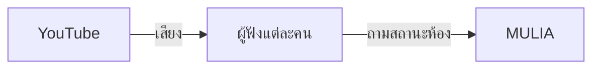

# MULIA

ห้องฟังเพลงด้วยกัน เปิดห้อง วางลิงก์ แล้วทุกคนได้ยินเพลงเดียวกัน ในจังหวะเดียวกัน

เลือกเข้าห้อง ฟังไปพร้อมกัน และอยู่กับเสียงนั้น โดยไม่ต้องส่งไฟล์เพลงหากัน

## เสียงเดินทางยังไง

แต่ละเครื่องเปิด YouTube เอง MULIA ถือแค่สถานะของห้องว่าเพลงอะไร กำลังเล่นหรือหยุด และเริ่มที่วินาทีไหน เครื่องผู้ฟังเอาเวลานั้นไปจูนเครื่องเล่นของตัวเอง



ไฟล์เพลงจึงไม่วิ่งผ่านเซิร์ฟเวอร์ เซิร์ฟเวอร์ตอบว่าห้องเป็นอย่างไร แล้วแต่ละเครื่องเล่นเอง

## ในห้อง

- ตั้งชื่อแล้วเข้าห้อง หรือเปิดห้องใหม่จากหน้ารายการห้อง
- วางลิงก์ YouTube หรือ YouTube Music เข้าคิว ลากจัดลำดับได้
- กดเล่นครั้งเดียว ทั้งห้องเดินนาฬิกาเดียวกัน เลื่อนตำแหน่งได้
- คนที่เข้ามาขณะเพลงกำลังเล่น จะได้ยินจากจุดที่ห้องฟังอยู่
- แชร์ด้วยรหัสห้องหรือคิวอาร์ เห็นว่าใครอยู่ในห้อง
- สลับโหมดสว่างกับโหมดมืด โทนกระดาษกับสีทอง

## เริ่มบนเครื่อง

ใช้ Node.js 22 ขึ้นไป เพราะห้องถูกเก็บด้วย SQLite ในตัว Node

```bash
npm install
npm run dev
```

เปิด [http://localhost:3000](http://localhost:3000)

สร้างห้องจากหน้าแรกหรือหน้ารายการห้อง แล้วส่งลิงก์ `/r/รหัสห้อง` ให้คนที่อยากฟังด้วย

| คำสั่ง | ทำอะไร |
| --- | --- |
| `npm run dev` | เปิดโหมดพัฒนา |
| `npm run build` | สร้างชุดสำหรับรันจริง |
| `npm start` | รันชุดที่สร้างแล้ว |
| `npm run lint` | ตรวจโค้ด |

สคริปต์เหล่านี้ใส่ `--experimental-sqlite` ให้อยู่แล้ว

## ข้อมูลห้อง

ห้อง คิว สมาชิก และนาฬิกาการเล่นอยู่ใน `data/sound-index.db` โฟลเดอร์นี้ไม่ถูกส่งขึ้น git ลบไฟล์นี้แล้วยังไม่มีห้อง

ชื่อและธีมของแต่ละคนอยู่บนเบราว์เซอร์ ไม่ได้อยู่ในฐานข้อมูล

รันบนเครื่องเดียวที่เก็บไฟล์นี้ไว้ได้ ถ้าย้ายไปโฮสต์ที่ไม่มีดิสก์ถาวร ห้องจะไม่คงอยู่หลังรีสตาร์ต

## แผนที่สั้น ๆ

| ที่ | ความหมาย |
| --- | --- |
| `/` | หน้าแรก ถ้ามีห้องกำลังฟังอยู่ จะพาเข้าไปได้เลย |
| `/archive` | รายการห้อง เปิดห้องใหม่ หรือใส่รหัสเพื่อเข้า |
| `/enter` | ตั้งชื่อก่อนเข้า |
| `/r/[code]` | ห้องฟัง จานเพลง คิว และคนในห้อง |
| `src/lib/rooms.ts` | สถานะห้องและคิว |
| `src/components/vinyl.tsx` | จานเพลงกับเครื่องเล่น YouTube |
